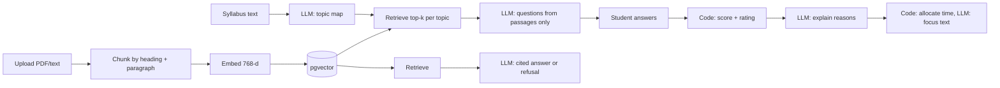

# GapFinder AI

Finds what a student doesn't know they don't know. Upload a syllabus, notes and past papers; GapFinder maps topics, quizzes from *your* material (with citations), rates each topic weak / medium / strong, and builds a revision plan that updates after every attempt.

**Stack:** Next.js 14 (App Router) · TypeScript · Tailwind · Supabase Postgres + pgvector · NextAuth (credentials) · Vercel AI SDK + Gemini.

## Setup
1. Create a Supabase project, open the SQL editor and run `supabase/schema.sql`.
2. `cp .env.example .env.local` and fill in the keys (Supabase URL + service-role key, Gemini API key, a NextAuth secret).
3. `npm install && npm run seed && npm run dev`
4. Sign in at http://localhost:3000 with **demo@gapfinder.app / Demo@1234** (sample Operating Systems material is preloaded). In *Materials*, click **Build from syllabus**, then take the quiz.
5. Deploy: import the repo in Vercel, add the same env vars, run `npm run seed` once against the production database.

## Architecture

## RAG pipeline
- **Chunking** (`lib/chunk.ts`): paragraph-aware ~900 chars, one-paragraph overlap, each chunk tagged `heading (p.N)` for citations.
- **Embedding** (`lib/ai.ts`): Gemini embedding model at 768 dims; documents and queries use different task types.
- **Retrieval** (`lib/rag.ts`): cosine search via `match_chunks`, scoped to the user, optionally by material type, with a minimum-similarity cutoff. Empty retrieval means no question or answer is produced.

## Where retrieval ends and generation begins
Retrieval is the only path from the student's files into a prompt, and prompts say "use only these passages". Every question stores `source_chunk_id` and a citation. Ratings and time allocation are plain code, so the diagnosis is reproducible; the LLM only writes the explanation and wording around them. Topics with no matching material are skipped rather than invented.

## AI workflow
Topic map (generate) → quiz (retrieve, then generate) → evaluation (code grades; LLM explains wrong answers from the source passage) → gap analysis (code rates; LLM explains) → plan (code schedules; LLM writes focus) → Ask (retrieve, then generate or refuse).

## Limitations
- Scanned/image PDFs need OCR (not included). Multiple-choice only; no short-answer grading yet.
- Ratings from 1–3 questions per topic are noisy; confidence grows with attempts.
- Topic names depend on the syllabus quality; very large uploads should be ingested in a background job.
- Not yet compiled or load-tested in the authoring environment: run `npm run build` and fix any type drift from newer package versions.

## Future
Teacher/class analytics, spaced-repetition reminders, multi-subject and multi-language support, LMS integration, retrieval evaluation set.
